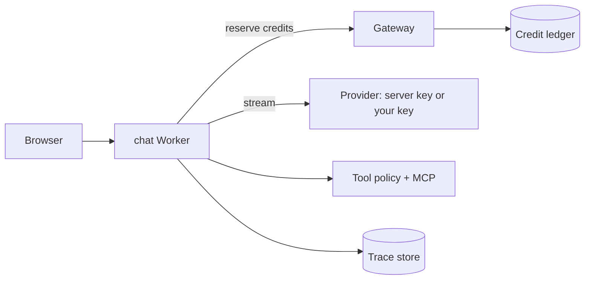

# Agent Workspace

**An agentic chat you can inspect.** Bring your own model, watch every tool call, delete everything when you are done.

Live (planned): **chat.adityacuz.in** · Part of [adityacuz.in](https://adityacuz.in) · MIT licensed

> **Status: design phase.** This repo currently holds the architecture, security model and roadmap. Nothing below is shipped yet; each item is labelled *planned*.

## Why it exists
Most chat UIs hide what the agent actually did. Agent Workspace is built around three ideas:

1. **Transparent runs** - every turn is a trace: plan, tool calls with timings, retrieved context, tokens, cost. Open any run in [Agent Labs](https://github.com/aditya4232/agent-labs) (Trace Lab).
2. **Your keys, your data** - bring an OpenAI- or Anthropic-compatible base URL and key. Session-only by default (not stored); saving a key is an explicit opt-in. Chat history is yours to delete (hard delete) or export.
3. **Safe tools** - tool calls go through a deterministic policy (allowlist, argument validation, human approval for side effects). Retrieved text and tool output are treated as untrusted.

## Planned features
| Area | What | Status |
|---|---|---|
| Providers | Default model via Command Code (DeepSeek); custom OpenAI/Anthropic-compatible endpoints; mid-thread model switch with fallback | planned |
| Tools | Inline tool chips with timing, MCP client with per-request allowlists and approvals | planned |
| Workspace | Artifacts panel, citations (RAG over your uploads), compare-models view | planned |
| Privacy | Session-only keys, opt-in encrypted key vault, "don't save" mode, delete + export | planned |
| Embed | Site-wide launcher button on adityacuz.in (iframe, locked `frame-ancestors`) | planned |
| Limits | 10 free credits/day per signed-in user, enforced server-side by the adityacuz platform | planned |

## Architecture (summary)

Details: [docs/ARCHITECTURE.md](docs/ARCHITECTURE.md) · Roadmap: [docs/ROADMAP.md](docs/ROADMAP.md) · Decisions: [docs/DECISIONS](docs/DECISIONS)

## Stack (planned)
Astro on Cloudflare Workers, React islands, Vercel AI SDK core, Cloudflare Durable Objects for per-user state, Neon Postgres via Hyperdrive. Credits, limits and admin controls live in a private platform repo behind an API, so this public code cannot be used to bypass quotas.

## Security
See [SECURITY.md](SECURITY.md). Never put real API keys in issues.

## Contributing
Design-phase repo: open an issue to discuss before sending code. See [CONTRIBUTING.md](CONTRIBUTING.md).